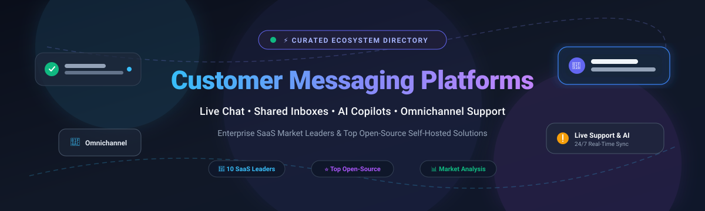

  

# 💬 Awesome Customer Messaging Platform Ecosystem

> 🌟 **A curated directory of top-tier SaaS customer messaging platforms and standout open-source self-hosted solutions for live chat, shared inboxes, omnichannel support, and AI chatbots.**

---

## 📌 Table of Contents

- [🎯 Overview](#-overview)
- [📈 Sector Overview & Market Dynamics](#-sector-overview--market-dynamics)
- [🏢 SaaS & Hosted Customer Messaging Platforms](#-saas--hosted-customer-messaging-platforms)
- [💻 Top Open-Source GitHub Projects](#-top-open-source-github-projects)
- [🔍 Architectural Insights: SaaS vs Self-Hosted](#-architectural-insights-saas-vs-self-hosted)
- [🤝 How to Contribute](#-how-to-contribute)
- [💖 Support](#-support)
- [⭐ Star History](#-star-history)
- [⚖️ Disclaimer & Compliance](#-disclaimer--compliance)

---

## 🎯 Overview

Customer Messaging Platforms enable modern e-commerce merchants, enterprise B2B sales teams, and customer support organizations to engage users in real-time across multiple touchpoints—including website live chat widgets, mobile in-app SDKs, email shared inboxes, WhatsApp Business API, SMS, and social media DMs.

Key capabilities tracked in this ecosystem:
- ⚡ **Real-Time Live Chat Widgets & Mobile SDKs**: Low-latency communication across web, iOS, Android, and React Native.
- 📬 **Omnichannel Shared Inboxes**: Unified ticket and message queues across email, WhatsApp, Messenger, and Instagram.
- 🤖 **AI Support Bots & Copilots**: Automated deflection, intent detection, and automated order lookups.
- 🛒 **E-Commerce Context**: Deep cart insights, order editing, refund triggers, and revenue attribution.

---

## 📈 Sector Overview & Market Dynamics

The global customer messaging and conversational support software market was valued at approximately **$10.5 billion in 2025** and is projected to expand to over **$27 billion by 2032**, demonstrating a robust compound annual growth rate (**CAGR of ~14.5%**).

The market exhibits **moderate fragmentation with strong vertical clustering** rather than a winner-take-all monopoly: while enterprise suites (Zendesk, Freshworks, Salesforce Service Cloud) dominate multi-channel IT and legacy help desk deployments, specialized contenders command defensible niches—such as Intercom in product-led B2B SaaS onboarding, Gorgias in direct-to-consumer (DTC) Shopify commerce, and Drift/Salesloft in conversational sales pipelines. Concurrently, privacy regulations (GDPR/HIPAA) and API pricing shifts are catalyzing growing enterprise interest in robust open-source, self-hosted alternatives like Chatwoot, Rocket.Chat, and FreeScout.

---

## 🏢 SaaS & Hosted Customer Messaging Platforms

The following table summarizes the market leaders in hosted customer messaging, categorized and sorted by estimated company size (market valuation or annual revenue run-rate):

| Company / Product | Company Size (Valuation / Revenue) 📊 | Starting Tier Pricing 🏷️ | Free Tier / Free Trial Limits ⏱️ | Key Strengths & Use Cases 💡 |
| :--- | :--- | :--- | :--- | :--- |
| **[Shopify Inbox](https://help.shopify.com/en/manual/inbox)** | **~$125B+ Market Cap** (Part of Shopify Inc. NYSE: SHOP; ~$8.8B+ FY24 Rev) | Included with Shopify subscription (from **$39/mo** Shopify Basic) | **Free Forever** for all Shopify store merchants with active subscriptions; includes unlimited chats, staff seats, and Inbox AI assistant | Native Shopify admin integration, instant cart and order history insights, discount code sharing, and product recommendation cards. |
| **[Zendesk Chat](https://www.zendesk.com/)** | **~$10.2B Valuation** (Acquired by Hellman & Friedman / Permira; ~$1.7B ARR) | **$55/agent/month** (Suite Team tier, billed annually) | **14-day Free Trial** with full access to Zendesk Suite Team (multi-channel ticketing, messaging, help center, and pre-built analytics; no credit card required) | Enterprise-grade omnichannel ticketing, unified agent workspace, workforce management, and enterprise security compliance. |
| **[Freshchat](https://www.freshworks.com/)** | **~$4.5B Market Cap** (Freshworks Inc. NASDAQ: FRSH; ~$700M+ ARR) | **$19/agent/month** (Growth tier, billed annually) | **Free Forever Plan** for up to **10 agents** with basic chat widgets, incoming conversation management, and native mobile apps; or **14-day Free Trial** for paid plans | Integrated omnichannel messaging (WhatsApp, LINE, Messenger), auto-assignment routing, and conversational AI bots. |
| **[Drift](https://www.drift.com/)** | **~$1.2B Valuation** (Acquired by Salesloft / Vista Equity Partners; ~$120M ARR) | **$2,500/month** (Premium tier, billed annually) | **No Free Tier**; structured **custom evaluation pilot / demo** upon qualifying sales consultation (typically 14 to 30 days) | Conversational marketing, automated sales meeting scheduling, B2B account-based marketing (ABM) buyer de-anonymization, and CRM pipeline acceleration. |
| **[Intercom](https://www.intercom.com/)** | **~$1.25B Valuation** (~$300M ARR; backing from Bessemer, Index, Kleiner Perkins) | **$39/seat/month** (Essential tier, billed annually) | **14-day Free Trial** with complete platform access (Fin AI Copilot, outbound messaging, Messenger customization, product tours; no credit card required) | AI-first customer service with Fin Copilot, modular Messenger widget spaces, proactive product onboarding, and surveys. |
| **[Gorgias](https://www.gorgias.com/)** | **~$710M Valuation** (~$70M ARR; backed by Sequoia Capital & Bessemer) | **$10/month** (Starter plan with 50 billable tickets/month) | **7-day Free Trial** with full feature access and up to 50 complimentary test tickets; no credit card required | Purpose-built DTC e-commerce help desk with deep Shopify & BigCommerce order editing, refund triggers, and support revenue attribution. |
| **[LiveChat](https://www.livechat.com/)** | **~$650M Market Cap** (Text S.A. WSE: TXT; ~$90M ARR) | **$20/agent/month** (Starter tier, billed annually) | **14-day Free Trial** with full Team tier feature set (unlimited chat history, full widget customization, basic analytics; no credit card required) | Ultra-reliable dedicated chat engine, rich chat tags, proactive visitor engagement triggers, staffing predictions, and 200+ integrations. |
| **[Tidio](https://www.tidio.com/)** | **~$150M Valuation** (~$25M ARR; backed by Peak Capital & Inovo VC) | **$29/month** (Starter tier, includes 3 seats and 100 handled conversations) | **Free Forever Plan** for up to **50 handled conversations/month** with 3 operator seats, live chat widget, and ticketing; or **7-day Free Trial** for Lyro AI | Lightweight live chat widget with Lyro AI customer deflection, visual no-code bot builder, and one-click WordPress/Shopify plugins. |
| **[Crisp](https://crisp.chat/)** | **~$50M Valuation** (Bootstrapped & profitable; ~$12M ARR) | **$25/workspace/month** (Pro tier, includes 4 operator seats) | **Free Forever Plan** for up to **2 operator seats** with basic live chat widget, 30-day chat history, and contact form; or **14-day Free Trial** for Pro/Unlimited | Unified shared inbox, multi-lingual knowledge base, co-browsing/LiveAssist, and extensive MIT-licensed developer SDKs. |
| **[Olark](https://www.olark.com/)** | **~$20M Valuation** (Bootstrapped & profitable; ~$6M ARR) | **$29/agent/month** (Standard plan, billed monthly or discounted annually) | **14-day Free Trial** with full platform capabilities, unrestricted chat volume, and team reporting; no credit card required | Lightweight live chat with real-time visitor cart tracking, automated chat routing, transcript search, and JavaScript API customization. |

---

## 💻 Top Open-Source GitHub Projects

The table below lists notable open-source customer messaging platforms, self-hosted shared inboxes, and live chat engines, **sorted in descending order by GitHub_Stars**:

| Project / Repository | GitHub_Stars 🌟 | Primary Stack 🛠️ | License 📄 | Architecture & Highlights 🚀 |
| :--- | :--- | :--- | :--- | :--- |
| **[Rocket.Chat](https://github.com/RocketChat/Rocket.Chat)** |  | TypeScript, Node.js, MongoDB | MIT / EE | Enterprise communications platform with dedicated omnichannel customer live chat widget, video conferencing, Matrix federation, and strict compliance controls (HIPAA, GDPR). |
| **[Chatwoot](https://github.com/chatwoot/chatwoot)** |  | Ruby on Rails, Vue.js, PostgreSQL | MIT / EE | Turnkey open-source customer engagement platform and Intercom alternative. Features live chat widgets, shared team inboxes, WhatsApp Business, SMS, Facebook Messenger, and Dialogflow/Rasa AI bots. |
| **[Documenso](https://github.com/documenso/documenso)** |  | TypeScript, Next.js, Prisma, Tailwind | AGPL-3.0 | Modern open-source signing and customer document dispatch infrastructure, providing customer-facing sign flows and embeddable messaging confirmation loops. |
| **[Botpress](https://github.com/botpress/botpress)** |  | TypeScript, Node.js, React | AGPL-3.0 | Developer-centric conversational AI engine for building autonomous customer support agents, generative AI bots, and live chat deflection workflows. |
| **[Papercups](https://github.com/papercups-io/papercups)** |  | Elixir, Phoenix, React, TypeScript | MIT | High-performance open-source live customer messaging widget written in Elixir; seamlessly routes web chats to Slack or Mattermost channels so agents reply directly from team chat. |
| **[Zammad](https://github.com/zammad/zammad)** |  | Ruby on Rails, JavaScript, PostgreSQL | AGPL-3.0 | Fully featured web-based open-source ticketing and support desk with built-in live chat channels, auto-assignment workflows, audit logs, and REST APIs. |
| **[FreeScout](https://github.com/freescout-help-desk/freescout)** |  | PHP, Laravel, MySQL | AGPL-3.0 | Lightweight, self-hosted shared inbox and help desk designed as a free Zendesk/Help Scout alternative. Supports omnichannel modules (Live Chat, WhatsApp, Telegram, Slack), unlimited agents, and 1-click deploys. |
| **[Chaskiq](https://github.com/chaskiq/chaskiq)** |  | Ruby on Rails, React, ActionCable | AGPL-3.0 | Full-featured conversational marketing and customer support platform modeled after Intercom and Drift. Offers customizable live chat widgets, proactive campaigns, onboarding tours, and bot builders. |
| **[Frappe Helpdesk](https://github.com/frappe/helpdesk)** |  | Python, Frappe Framework, Vue.js | AGPL-3.0 | Modern open-source help desk and customer ticketing system with SLA tracking, agent collaboration, customer portal, and native Frappe/ERPNext business data synchronization. |
| **[Live Helper Chat](https://github.com/livehelperchat/livehelperchat)** |  | PHP, JavaScript, MySQL | Apache-2.0 | Veteran, highly customizable self-hosted live chat server supporting voice, video, Telegram, WhatsApp, co-browsing, and desktop notification agents. |
| **[Tiledesk](https://github.com/tiledesk/tiledesk)** |  | Node.js, Express, MongoDB | MIT | Open-source live chat and conversational AI framework with visual bot design studio, omnichannel routing, and native iOS/Android SDKs. |
| **[Crisp Web SDK](https://github.com/crisp-im/crisp-sdk-web)** |  | TypeScript, JavaScript | MIT | Production-ready open-source frontend chat widget SDK wrapper for integrating Crisp's messaging backend into React, Vue, Angular, and vanilla web apps. |

---

## 🔍 Architectural Insights: SaaS vs Self-Hosted

When evaluating customer messaging stacks, organizations face trade-offs across four primary axes:

1. **Data Sovereignty & Privacy (GDPR/HIPAA)**:
   - *Self-Hosted (Chatwoot, FreeScout, Rocket.Chat)*: Complete control over databases, message retention, and zero external PII leakage.
   - *SaaS (Zendesk, Intercom)*: Requires Data Processing Agreements (DPAs) and reliance on SOC2 compliance certifications.
2. **Setup Overhead & Maintenance**:
   - *SaaS*: Instant 5-minute script installation with zero infrastructure management.
   - *Self-Hosted*: Requires configuring Redis, WebSockets, background workers (Sidekiq/Celery), SMTP servers, and mobile push notification relays.
3. **Omnichannel Depth vs Live-Chat-First**:
   - *SaaS*: Highly polished live chat widgets, rich cards, automated order cancellations, and AI co-pilots out of the box.
   - *Self-Hosted*: Exceptionally strong for email ticketing and shared inboxes, but custom in-app product tours or deep Shopify integrations typically require custom development.

---

## 🤝 How to Contribute

We welcome additions, corrections, and updates from the open-source and customer messaging communities!

1. 🍴 **Fork the repository**.
2. 🌿 **Create a descriptive feature branch** (`git checkout -b add-my-messaging-tool`).
3. 📝 **Add or update entries** in `README.md` maintaining table formatting, pricing precision, and stargazer badge links.
4. 🚀 **Commit your changes** (`git commit -m "feat: add NewTool to open-source table"`).
5. 📬 **Submit a Pull Request** with a concise summary of the project.

---

## 💖 Support

Thank you so much for exploring and using this curated customer messaging platform repository! 🙏

If you found this ecosystem overview, market insights, or open-source list useful, please consider:
- ⭐ **Starring** this repository to help others discover it.
- 🍴 **Forking** and contributing additional projects or updates.
- 📢 **Sharing** with fellow engineers, founders, and product teams.
- ☕ **Buying a coffee / sponsoring** the author via the [GitHub Sponsors Dashboard](https://github.com/sponsors/ishandutta2007) to support continuous maintenance of open-source research and awesome lists!

---

## ⭐ Star History

---

## ⚖️ Disclaimer & Compliance

- This repository is a community-maintained resource for educational and architectural evaluation purposes. It is not directly affiliated with, sponsored by, or endorsed by any vendor listed herein.
- Customer messaging systems process personally identifiable information (PII). Ensure your deployment adheres to applicable data privacy legislation (GDPR, CCPA/CPRA, HIPAA) and implements secure encryption at rest and in transit.
- Verify licenses directly in upstream repositories prior to enterprise commercial deployment.

---

  Curated with ❤️ by the community. Star ⭐ this repo if you find it helpful!

